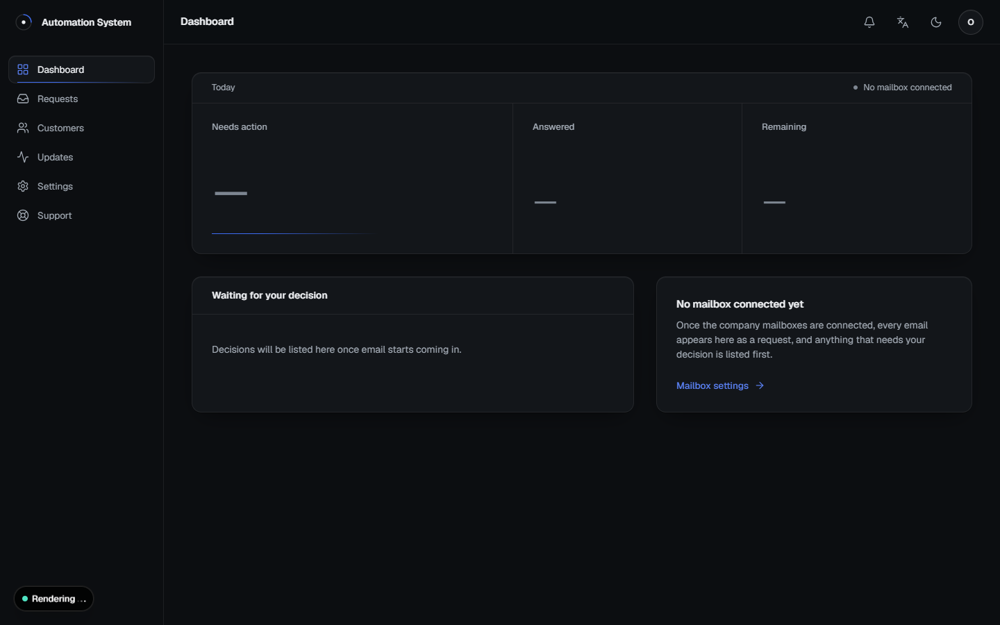
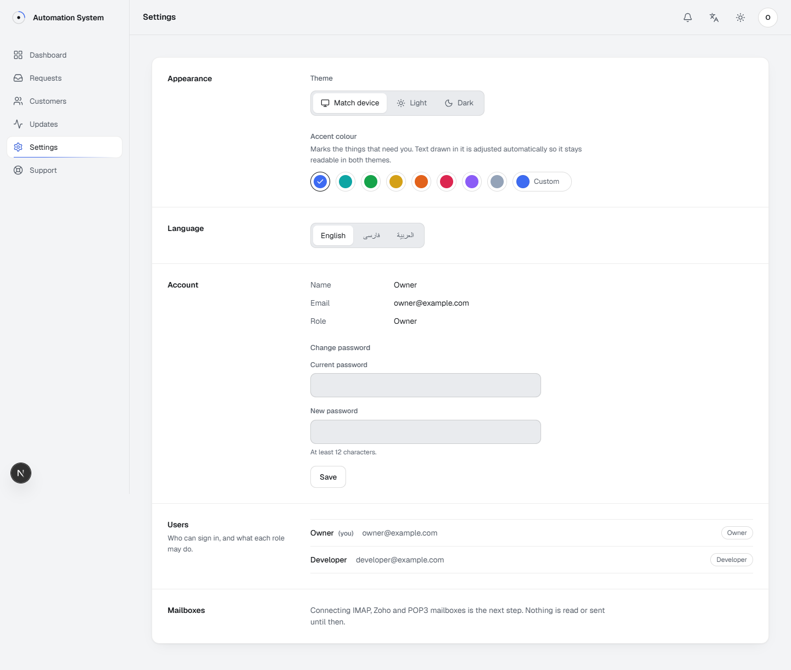
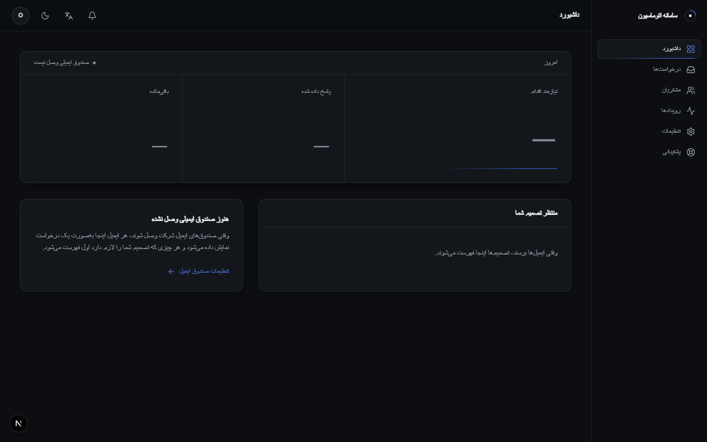
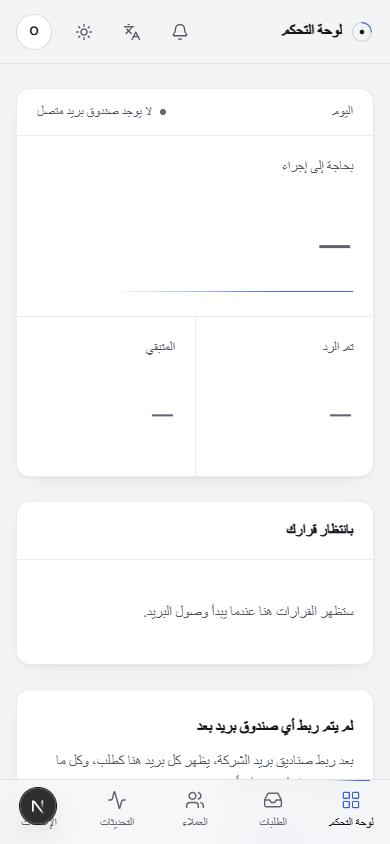

# Automation System

An internal web app for a B2B energy and chemicals supplier. It reads the
company's mailboxes, turns every email into a tracked request, answers buyers
through qualification and negotiation, and puts every decision that needs a
person on one dashboard.

> This repository is a showcase. The source code is private.

**Status:** in development. Stage 2 of 7 complete.

---

## What it does

- **Every email becomes a request.** Threads are grouped, categorised (Buyer,
  Supplier, Logistics, Spam, Other) and moved through a pipeline from first
  contact to payment.
- **A detail panel for each request.** The AI extracts the contact, company,
  product, grade, quantity, offered price, payment and delivery terms, port,
  location and deadline. Missing fields are asked for in the next reply.
- **Replies in the sender's language**, with an English view for the team.
- **Prices are never written by the AI.** Code chooses every figure from
  rules set by the business, and every outgoing email is checked for numbers
  that were not issued that way. Anything unexpected is held for a person.
- **People stay in charge of decisions.** Price offers, unusual requests and
  binding documents become call-to-action items with Decline / Counter /
  Approve buttons.
- **Customers** are saved automatically with their history, and past
  customers can be sent new offers with chosen attachments.
- **Notifications** in an in-app inbox and as desktop / mobile push, only for
  items that need action.
- **Support tickets** from the team straight to the developer.
- **English, Persian and Arabic**, with full right-to-left layout, light and
  dark themes and a custom accent colour.

## Rollout

Automatic sending is switched on one stage at a time.

| Stage | Delivers | Status |
| --- | --- | --- |
| 1 | Specification | ✅ Done |
| 2 | App shell: login, roles, layout, themes, EN / FA / AR with RTL | ✅ Done |
| 3 | Mailbox connection; every email becomes a request (read only) | Next |
| 4 | AI drafts, approved by a person | |
| 5 | Customers, notification inbox, push | |
| 6 | Pricing rules, outbound checks, staged automatic sending | |
| 7 | Offers to past customers, support tickets | |

## Stack

Next.js · React · TypeScript · Motion · Tailwind · Radix UI · Node ·
PostgreSQL · Prisma

## Screens

The dashboard is built like a car's digital cockpit: calm instruments, and one
lit line under the count that needs a decision. With no mailbox connected yet,
the readouts show "no signal" rather than pretending to measure zero.

| Settings, light | Persian, right to left |
| --- | --- |
|  |  |

## Updates

### 2026-11-11: App shell
- Sign-in with roles (owner, commercial, developer) and server-side sessions.
- Dashboard, Requests, Customers, Updates, Settings and Support sections.
- Light and dark themes, plus an accent colour picker; every colour the user
  picks is adjusted automatically to stay readable (WCAG AA) in both themes.
- English, Persian and Arabic, with the whole layout mirrored right to left.
- Phone layout with a bottom navigation bar.

### 2026-11-11: Specification
Requirements gathered and written up: roles, screens, request panel,
notification rules, pricing safeguards and the staged rollout.

---

© All rights reserved. Shown for portfolio purposes only.
